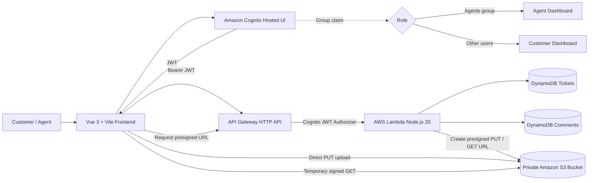

# TicketFlow — AWS Serverless Ticketing System

A serverless support-ticket proof of concept built with **Vue 3** and AWS managed services. TicketFlow provides separate Customer and Agent experiences, secure authentication with Amazon Cognito, persistent ticket data in DynamoDB, comments/activity tracking, and private S3 attachments using presigned URLs.

## Features

### Customer
- Sign up and sign in through Amazon Cognito
- Dedicated Customer dashboard
- Create support tickets
- Set priority and category
- Upload private attachments to Amazon S3
- View only their own tickets
- Track ticket status and assignee
- Add comments
- Download their ticket attachments securely

### Agent
- Sign in with Cognito Agent role
- Dedicated Agent dashboard
- View the complete support queue
- Search and filter tickets
- Update status
- Update priority
- Assign tickets
- Add Agent comments
- View ticket activity
- Download Customer attachments

## Role-based security

The selected portal does **not** grant permissions by itself.

- Normal Cognito users are treated as **Customers**
- Users in the Cognito group `Agents` are treated as **Agents**
- The frontend uses the role claim only to shape the UI
- The backend also verifies the Cognito JWT and enforces access
- Customers can only access tickets whose `customerId` matches their Cognito `sub`
- Only Agents can update ticket status, priority, and assignee

## Architecture



More detail: [`docs/ARCHITECTURE.md`](docs/ARCHITECTURE.md)

## AWS services

| Service | Purpose |
| --- | --- |
| Amazon Cognito | Authentication, Hosted UI, Customer/Agent role groups |
| API Gateway HTTP API | Secure REST API |
| AWS Lambda | Ticket, comment and attachment business logic |
| Amazon DynamoDB | Ticket and comment persistence |
| Amazon S3 | Private file attachments |
| IAM | Lambda execution and resource permissions |
| CloudWatch Logs | Lambda runtime logs |

## API endpoints

All endpoints are protected by Cognito JWT authentication.

| Method | Endpoint | Purpose |
| --- | --- | --- |
| `POST` | `/tickets` | Create a ticket |
| `GET` | `/tickets` | List/search/filter visible tickets |
| `GET` | `/tickets/{ticketId}` | Get one ticket |
| `PUT` | `/tickets/{ticketId}` | Agent-only ticket update |
| `GET` | `/tickets/{ticketId}/comments` | List comments |
| `POST` | `/tickets/{ticketId}/comments` | Add a comment |
| `POST` | `/tickets/presigned-url` | Generate secure S3 upload URL |

## Main ticket states

- Open
- In Progress
- Pending
- Resolved

Priorities:

- Low
- Medium
- High
- Urgent

## Project structure

```text
AWS-Ticketing-System/
├── backend/
│   └── lambda/
│       └── index.js
├── docs/
│   ├── ARCHITECTURE.md
│   ├── AWS_RESOURCES.md
│   ├── DEMO_SCRIPT.md
│   ├── SCREENSHOT_CHECKLIST.md
│   └── TEST_CHECKLIST.md
├── frontend/
│   ├── src/
│   ├── .env.example
│   └── package.json
├── scripts/
│   ├── provision-cognito.sh
│   ├── promote-agent.sh
│   ├── provision-backend.sh
│   ├── provision-s3-attachments.sh
│   └── build-submission.sh
└── README.md
```

## Prerequisites

- Node.js 20+
- npm
- AWS CLI v2
- `zip`
- An AWS account with permission to provision the required resources

Check:

```bash
node --version
npm --version
aws --version
aws sts get-caller-identity
```

> Never commit or submit AWS Access Keys, Secret Access Keys, session tokens, `.env.local`, or local AWS credential files.

## Local frontend setup

```bash
cd frontend
npm install
npm run dev
```

Default local URL:

```text
http://localhost:5173
```

## Environment variables

Create `frontend/.env.local` from the generated provisioning values.

Example keys:

```env
VITE_AWS_REGION=ap-south-1
VITE_COGNITO_USER_POOL_ID=YOUR_USER_POOL_ID
VITE_COGNITO_CLIENT_ID=YOUR_APP_CLIENT_ID
VITE_COGNITO_DOMAIN=https://YOUR_DOMAIN.auth.ap-south-1.amazoncognito.com
VITE_API_BASE_URL=https://YOUR_API_ID.execute-api.ap-south-1.amazonaws.com
```

A safe placeholder file is included as `frontend/.env.example`.

## Provisioning order

The project includes provisioning scripts. Run them from the project root.

### 1. Cognito

```bash
chmod +x scripts/*.sh
./scripts/provision-cognito.sh ap-south-1
```

### 2. Backend

```bash
./scripts/provision-backend.sh
```

### 3. S3 attachments

```bash
./scripts/provision-s3-attachments.sh
```

### 4. Start frontend

```bash
cd frontend
npm install
npm run dev
```

## Create an Agent account

First create/sign up a normal Cognito user, then run:

```bash
./scripts/promote-agent.sh agent@example.com
```

Sign out and sign back in after promotion so the new `cognito:groups` claim is included in the token.

## S3 attachment flow

Attachments do not pass through Lambda.

1. Vue requests `POST /tickets/presigned-url`
2. Lambda verifies the authenticated user
3. Lambda returns a short-lived presigned S3 PUT URL
4. Vue uploads the file directly to the private S3 bucket
5. The ticket stores only the S3 object key and file name in DynamoDB
6. When an authorized user opens the ticket, Lambda generates a short-lived download URL

The S3 bucket has public access blocked.

## Demo flow

A complete presentation flow is available in [`docs/DEMO_SCRIPT.md`](docs/DEMO_SCRIPT.md).

Recommended demo:

1. Customer sign in
2. Customer dashboard
3. Create ticket with attachment
4. Add Customer comment
5. Agent sign in
6. Agent dashboard
7. Open Customer ticket
8. Assign ticket and set `In Progress`
9. Add Agent reply
10. Download attachment
11. Return to Customer and show the updates

## Testing

Use [`docs/TEST_CHECKLIST.md`](docs/TEST_CHECKLIST.md) before submission.

## Screenshots

Use [`docs/SCREENSHOT_CHECKLIST.md`](docs/SCREENSHOT_CHECKLIST.md) to capture the final evidence required for a report or presentation.

## Build a clean submission ZIP

From the project root:

```bash
chmod +x scripts/build-submission.sh
./scripts/build-submission.sh
```

The script creates:

```text
dist-submission/AWS-Ticketing-System-Submission.zip
```

It intentionally excludes secrets and unnecessary files such as:

- `.env.local`
- `.cognito-resource-ids`
- `.backend-resource-ids`
- `node_modules`
- `.git`
- `.patch-backups`
- AWS credential files
- build caches

## Security notes

- Cognito authenticates users.
- API Gateway validates JWTs.
- Lambda performs authorization checks.
- Customers cannot retrieve arbitrary Customer tickets.
- Agent-only changes are enforced in Lambda.
- S3 public access is blocked.
- S3 transfers use temporary presigned URLs.
- Credentials are not stored in source code.

## Technology stack

**Frontend**
- Vue 3
- Vite
- Pinia
- Vue Router
- Lucide icons

**Backend**
- Node.js 20
- AWS Lambda
- API Gateway HTTP API
- AWS SDK v3

**Data and authentication**
- Amazon DynamoDB
- Amazon Cognito
- Amazon S3

## Project status

The POC implements the complete primary Customer/Agent ticket workflow:

**Authentication → role-based dashboard → ticket creation → comments → Agent updates → activity tracking → private S3 attachments.**
