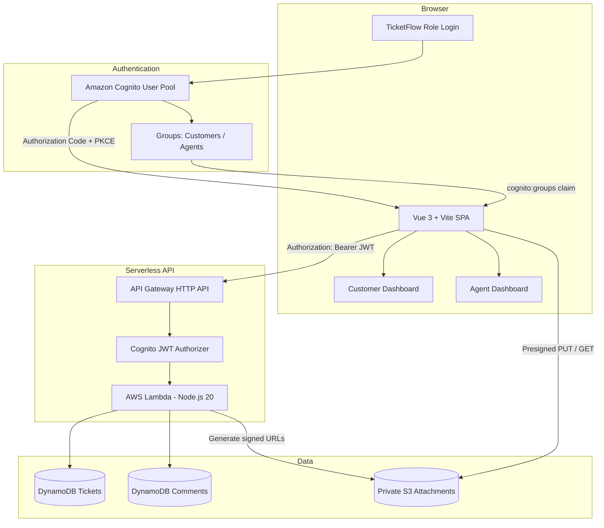
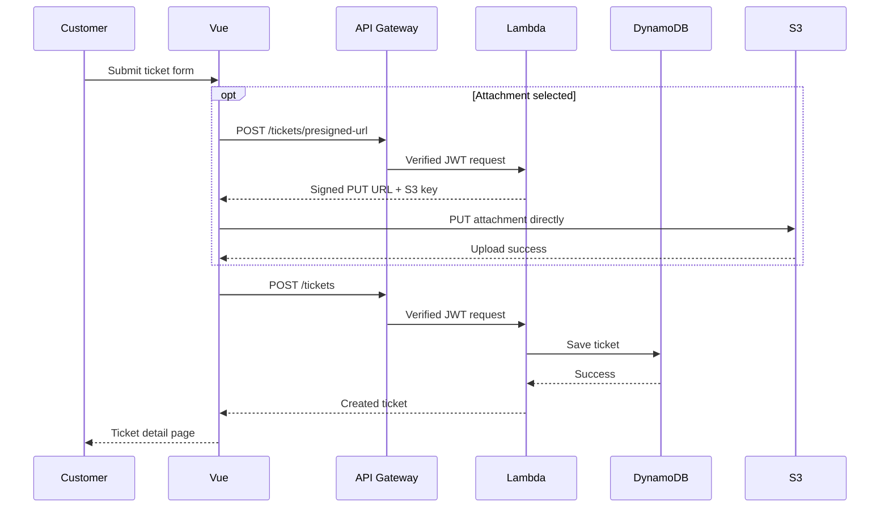

# Architecture

## High-level architecture



## Request flow

### Authentication

1. User opens TicketFlow.
2. User chooses Customer Portal or Agent Portal.
3. TicketFlow redirects to Amazon Cognito Hosted UI.
4. Cognito authenticates the user.
5. Cognito returns an authorization code.
6. The frontend completes the PKCE flow and receives tokens.
7. The app reads `cognito:groups`.
8. A user in `Agents` receives the Agent experience; other authenticated users receive the Customer experience.
9. Backend authorization does not rely on the button choice. Lambda checks the authenticated JWT claims.

### Customer ticket creation



### Ticket authorization

For a Customer:

```text
JWT sub == ticket.customerId
```

For an Agent:

```text
cognito:groups contains "Agents"
```

Only Agents can modify:

- status
- priority
- assignee

Customers and Agents can both add comments when they are authorized to view the ticket.

## S3 design

The attachment bucket is private.

Uploads:

```text
Browser -> API -> Lambda -> presigned PUT URL
Browser ------------------> S3
```

Downloads:

```text
Browser -> API -> Lambda -> authorization check -> presigned GET URL
Browser -----------------------------------------> S3
```

This avoids sending binary files through Lambda or API Gateway.

## DynamoDB

### Tickets table

Primary key:

```text
ticketId
```

Customer query index:

```text
customerId-createdAt-index
```

Typical attributes:

```text
ticketId
title
description
priority
category
status
customerId
customerName
customerEmail
assignee
attachmentKey
attachmentName
createdAt
updatedAt
activity[]
```

### Comments table

Partition key:

```text
ticketId
```

Sort key:

```text
commentId
```

Typical attributes:

```text
ticketId
commentId
authorId
authorName
role
message
createdAt
```

## Why this architecture

- Serverless and inexpensive for a POC
- No server management
- AWS-managed authentication
- Per-request authorization
- DynamoDB suits simple ticket access patterns
- S3 is designed for file storage
- Presigned URLs keep large file transfers away from Lambda
- Vue can remain a simple SPA
